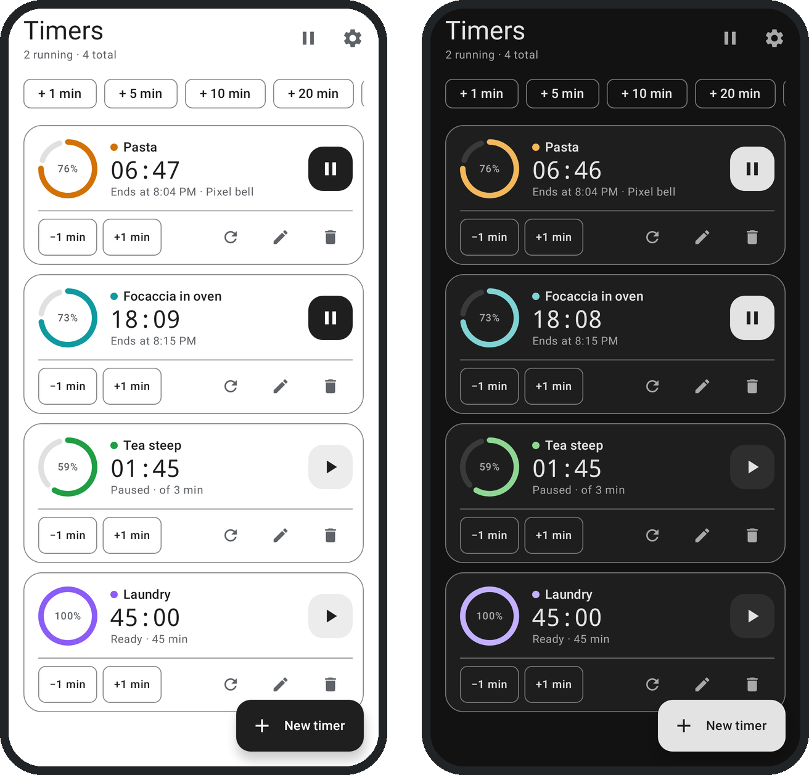

<picture>
  <source media="(prefers-color-scheme: dark)" srcset="docs/assets/banner-dark.svg">
  
</picture>

# Multi Timer

**Pasta on the stove, bread in the oven, laundry in the machine.** Multi Timer runs as many
countdowns as you need, side by side, and each one rings with its own retro 8-bit alarm.

  

## Highlights

- **Truly independent timers.** Start, pause, reset, edit or delete one without touching the others.
- **Quick to use.** One-tap chips for 1, 5, 10, 20 and 30 minutes and 1 hour; ±1 minute on every card.
- **Rings when it matters.** Timers finish on time with the app closed and the phone locked, and
  they ring even when your phone is set to vibrate.
- **Control from the notification shade.** Each timer shows a live countdown with Pause, +1 min and Reset.
- **Five original 8-bit sounds.** Power chime, Pixel bell, Beeper, Gentle rise and Jingle, or any
  of your phone's alarm sounds, chosen per timer.
- **Light and dark.** Clean neutral themes, following your phone or your choice.
- **Accessible.** WCAG 2.2 AA contrast, large touch targets, TalkBack labels, large-font support.
- **Private.** Works fully offline. No network access, no tracking, no ads.

## Requirements

Android 11 or newer. Built natively with Kotlin, Jetpack Compose and Material 3, with no
third-party libraries.

## Get started

Build it with Android Studio or from the command line. The
[developer guide](docs/README.md#open-and-run) has the steps.

## Learn more

| | |
|---|---|
| [Developer guide](docs/README.md) | How the app is built, release builds, permissions |
| [Specifications](openspec/specs) | What the app does, as OpenSpec requirements and scenarios |
| [Architecture decisions](docs/adr/README.md) | Why it is built this way |
| [Interactive mockup](docs/design/mockup.html) | Try the design in a browser, sounds included |
